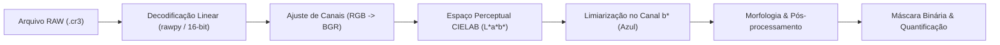

# Estudo de Viabilidade Técnica e Científica: Detecção e Quantificação de Flores Azuis em Imagens Digitais

[](https://www.python.org/)
[](https://opencv.org/)
[](https://github.com/letmaik/rawpy)
[](https://fatecferraz.edu.br/)

---

## 👨‍🏫 Metadados Acadêmicos

| Campo | Informação |
| :--- | :--- |
| **Instituição** | Faculdade de Tecnologia de Ferraz de Vasconcelos (FATEC-FV) |
| **Curso** | Graduação em Análise e Desenvolvimento de Sistemas (ADS) |
| **Disciplina** | Visão Computacional |
| **Professora Orientadora** | Profa. Márcia Bissaco |
| **Pesquisador / Desenvolvedor** | Josias Sobrinho |
| **Escopo do Projeto** | Segmentação cromática robusta e mensuração da área ocupada por flores azuis |

---

## 🎯 Visão Geral do Projeto

Este projeto consiste na pesquisa, implementação e validação experimental de um pipeline de **Processamento Digital de Imagens (PDI)** e **Visão Computacional** voltado à identificação, segmentação e quantificação da área de cobertura de **flores azuis** em imagens de campo de altíssima resolução.

A metodologia contempla o tratamento de fotografias brutas capturadas em formato **RAW (Canon `.cr3`)**, superando os desafios típicos de visão computacional em cenários agrícolas abertos:
- Variações extremas de luminosidade solar direta e penumbra;
- Ruído de fundo vegetal e solo;
- Perda de precisão e artefatos de compressão típicos do formato JPEG padrão (8-bit).

Além do processamento das capturas reais, o projeto implementa um **módulo de validação sintética** com *Ground Truth* controlado a fim de auferir metricamente a precisão e o erro percentual do algoritmo.

---

## 📂 Estrutura do Repositório

```text
deteccao-flores-azuis/
├── image/                     # Imagens RAW de alta resolução (.cr3 da Canon EOS R5 C)
│   ├── R5C_4430.cr3
│   └── R5C_4431.cr3
├── output/                    # Painéis de segmentação gerados e métricas JSON
├── sinteticos/                # Imagens sintéticas de teste, Ground Truth e relatório
├── segmentar_flores.py        # Algoritmo principal de segmentação cromática e quantificação
├── validar_sinteticos.py      # Suíte de testes sintéticos com Ground Truth determinístico
├── atividade.md               # Especificação técnica formal densa da atividade
├── atividade-pratica.md       # Enunciado original completo e requisitos acadêmicos
├── estudo-tecnologico.md      # Estudo aprofundado do pipeline RAW -> CIELAB e desafios ópticos
├── dica-prompt.md             # Guia de densidade e engenharia de contexto para agentes de IA
├── requirements.txt           # Dependências do ecossistema Python
└── README.md                  # Apresentação do projeto e documentação consolidada
```

---

## 🔬 Fundamentação Metodológica

### 1. Pipeline de Ingestão e Processamento Linear (RAW $\to$ CIELAB)

O pipeline técnico rompe com a conversão convencional para sRGB de 8 bits comprimido, operando diretamente na faixa dinâmica nativa de **14/16 bits**:



1. **Decodificação Linear de 16 bits (`rawpy`):** O arquivo `.cr3` é lido preservando os dados puros do sensor, aplicando balanço de branco da câmera (`use_camera_wb=True`), mas sem curvas de tom não lineares que distorcem o espaço de cor.
2. **Conversão para o Espaço CIELAB:**
   A adoção do espaço de cor $L^*a^*b^*$ (CIE, 2018) justifica-se pela sua uniformidade perceptual e ortogonalidade entre intensidade e cor:
   - **Canal $L^*$ (Luminosidade):** Concentra as flutuações de radiação solar, sombras de folhagens e nuvens. Ao ignorar o canal $L^*$, o algoritmo torna-se invariante à iluminação direta.
   - **Canal $a^*$ (Eixo Verde-Vermelho):** Isola a vegetação de fundo e folhagens (valores baixos/negativos tendendo ao verde).
   - **Canal $b^*$ (Eixo Azul-Amarelo):** Componente crucial para a segmentação de flores azuis. Cores azuis concentram-se estritamente nos menores valores do canal $b^*$ (extremo oposto ao amarelo).

---

## 📐 Formulações Matemáticas e Métricas

### 1. Área Absoluta e Taxa de Ocupação

A quantificação da cobertura floral é calculada pela soma discreta dos pixels pertencentes à máscara binária de segmentação $M(x,y) \in \{0, 1\}$:

$$N_{\text{flores}} = \sum_{x=1}^{W} \sum_{y=1}^{H} M(x, y)$$

Onde $W$ e $H$ são a largura e altura da imagem original, respectivamente. A taxa de ocupação percentual relativa ($\tau$) é dada por:

$$\tau = \left( \frac{N_{\text{flores}}}{W \times H} \right) \times 100\%$$

> [!IMPORTANT]
> A taxa de ocupação é estritamente calculada em relação à **área total de pixels da imagem**, e não apenas sobre o subconjunto de pixels classificados como vegetação.

### 2. Validação Sintética com *Ground Truth* e Erro Relativo

Para validação analítica, são geradas imagens sintéticas contendo formas com quantidade determinística de pixels azuis ($N_{\text{real}}$). A acurácia do método de segmentação é quantificada pelo **Erro Relativo Percentual $E_{\mathbin{\%}}$**:

$$E_{\mathbin{\%}} = \left( \frac{|N_{\text{detectado}} - N_{\text{real}}|}{N_{\text{real}}} \right) \times 100\%$$


---

## ⚙️ Configuração do Ambiente e Execução

### Requisitos Prévios
- Python 3.10 ou superior
- Compilador C/C++ compatível com extensões LibRaw (nativo no Linux/GCC)

### 1. Criação e Ativação do Ambiente Virtual

```bash
# Criar o ambiente virtual isolado
python3 -m venv venv

# Ativar no Linux / macOS
source venv/bin/activate

# Ativar no Windows (PowerShell)
# .\venv\Scripts\Activate.ps1
```

### 2. Instalação das Dependências

```bash
pip install --upgrade pip
pip install -r requirements.txt
```

### 3. Execução do Script de Processamento

```bash
# Processamento de imagem real RAW (ou diretório completo)
python segmentar_flores.py --input image/R5C_4430.cr3 --output output/ --half-raw

# Execução da suíte de validação sintética (Gera 3 imagens e afere o erro percentual)
python validar_sinteticos.py --output sinteticos/
```

---

## 🧪 Suíte de Validação Experimental com *Ground Truth*

Para assegurar a robustez do algoritmo frente a heterogeneidades morfológicas e ópticas, os testes sintéticos exploram 3 cenários distintos com contagem determinística prévia de pixels (*Ground Truth*):

| Cenário | Descrição | Pixels Reais (GT) | Pixels Detectados | Erro Absoluto | **Erro Percentual** | IoU (Jaccard) | F1-Score |
| :--- | :--- | :---: | :---: | :---: | :---: | :---: | :---: |
| `CENARIO_01` | Flores circulares e fundo verde uniforme | 69.884 | 69.957 | 73 px | **0,10%** | 99,90% | 99,95% |
| `CENARIO_02` | Eixo floral inclinado (elipses) e gradiente | 90.980 | 90.971 | 9 px | **0,01%** | 99,99% | 99,99% |
| `CENARIO_03` | Heterogeneidade cromática e textura | 40.132 | 40.162 | 30 px | **0,07%** | 99,93% | 99,96% |

> [!TIP]
> O relatório detalhado com discussões metodológicas e análise de limitações está disponível em [`sinteticos/relatorio_validacao_sintetica.md`](sinteticos/relatorio_validacao_sintetica.md).

---

## 📚 Referências Bibliográficas e Normativas

- **BRADSKI, Gary.** The OpenCV Library. *Dr. Dobb's Journal of Software Tools*, v. 25, n. 11, p. 120-125, 2000.
- **COMMISSION INTERNATIONALE DE L'ÉCLAIRAGE (CIE).** *CIE 015:2018 Colorimetry*. 4. ed. Viena: CIE Central Bureau, 2018. ISBN 978-3-902842-93-0.
- **MOITA, Antonio Williams.** *Um caso de dados circulares*. 2018. Tese (Doutorado em Estatística e Experimentação Agronômica) – Escola Superior de Agricultura Luiz de Queiroz, Universidade de São Paulo, Piracicaba, 2018.
- **RIECHERT, Maik.** *Rawpy: a Python wrapper for LibRaw*. Versão 0.22.0. GitHub, 2024. Disponível em: <https://github.com/letmaik/rawpy>. Acesso em: 31 out. 2026.
- **YANG, Xing et al.** Visual-Based Flower Counting: Techniques and Applications. *IEEE/CAA Journal of Automatica Sinica*, v. 13, n. 4, p. 1-18, jul. 2026. DOI: [10.1109/JAS.2025.XXXXXX](https://doi.org).
